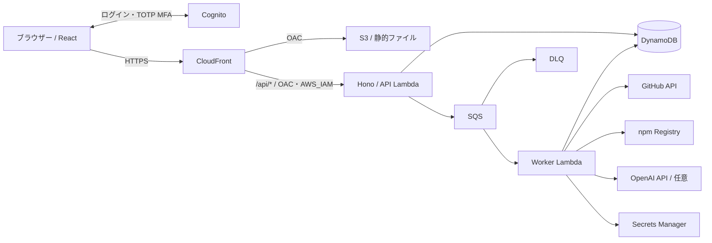

# Repo Sentinel — アーキテクチャ

公開GitHubリポジトリのnpm依存関係を監査し、結果を日本語で説明する、本人1人用のWebアプリです。導入方法は [セルフホスト手順](SELF_HOSTING.md) を参照してください。

## AWS構成

1. CognitoのAuthorization Code Flow + PKCEでログインします。新規登録は禁止し、管理者が作成した1ユーザーだけを許可します。
2. APIはアクセストークンの署名・Issuer・期限・用途・Client ID・許可済み`sub`を検証します。CloudFrontの署名と区別するため、JWTは`X-Access-Token`で渡します。
3. 監査開始時にDynamoDBへ`PENDING`ジョブを保存し、SQSへ通知します。日次5回・同時1件をトランザクションで制限します。
4. Workerが`RUNNING`へ遷移し、デフォルトブランチのSHAを確定して、同じSHAのルート`package.json`と`package-lock.json`を取得します。隔離した一時ディレクトリで`npm audit --package-lock-only --ignore-scripts`を実行します。
5. 機械監査結果と、モックまたはOpenAIによる説明を検証・保存します。画面は約2.5秒間隔のポーリングで`COMPLETED`／`FAILED`を表示します。脆弱性の検出と処理の失敗は別に扱います。

## 実装の配置

| ディレクトリ | 役割 |
|---|---|
| `frontend/app` | React・Viteによる画面、認証、API通信 |
| `api/app` | Hono API、JWT認証、ローカル／Lambdaの起動処理 |
| `workers/security-audit/app` | GitHub取得、npm監査、AI説明、SQS処理 |
| `packages/core` | 共有型・Zodスキーマ・制限値 |
| `packages/aws` | DynamoDB・SQS・Secrets Manager・予算予約 |
| `infra/terraform` / `scripts` | AWSリソース定義、ビルド・配布・初期ユーザー作成 |

TypeScript・npm workspacesと、ルートの単一`package-lock.json`を使います。AWS向けにはクリーン環境でFrontend、Lambda ZIP、npm Layerを作成します。

## 認証・データ・費用の境界

- S3は非公開です。Function URLは`AWS_IAM`認証とし、CloudFront OAC経由に制限します。API応答はキャッシュしません。ブラウザーのトークンはメモリに保持します。
- 外部リポジトリをデータとして扱い、依存インストール・npmスクリプト・任意コードを実行しません。接続先、取得サイズ、出力サイズ、処理時間を制限します。
- DynamoDBに履歴、日次回数、全体実行ロック、AI開始マーカー・予算予約を保存します。SQSの重複通知でも開始済みジョブを再実行せず、期限切れは失敗として確定します。
- OpenAIの鍵はWorkerだけがSecrets Managerから取得します。AIは原則1回／ジョブ、最大2,048出力トークン、日次5回、月額$10相当の予約枠（1回$0.05）で制限します。予約額は実請求額ではなく、プロバイダー側の支出制限も別途必要です。
- 新規登録禁止とAPI認可は第三者の監査・AI実行を防ぎます。未認証HTTPリクエストを受けて拒否する際のインフラ利用は別に発生します。

## ローカル構成と対応範囲

Docker ComposeでVite、Hono、DynamoDB Localを起動し、loopbackだけにポートを公開します。認証はAWSのCognitoを使います。全体モックはAPI内で自動処理し、実監査はComposeのWorkerをCLIから実行します。ローカルにSQSは置きません。DynamoDB Localはインメモリで、停止・再起動すると履歴が消えます。ローカル実AIの予算台帳は`.local/ai-usage/`に保存します。

対象は公開リポジトリのルートnpmプロジェクトとlockfileVersion 2／3です。非公開リポジトリ、workspaces、git・file・任意URL依存は未対応です。依存監査とAI説明はソースコード全体の安全性を保証しません。現行のAWS実装は東京リージョン・`dev`環境を前提とするPoCで、本番環境の構築定義はありません。
