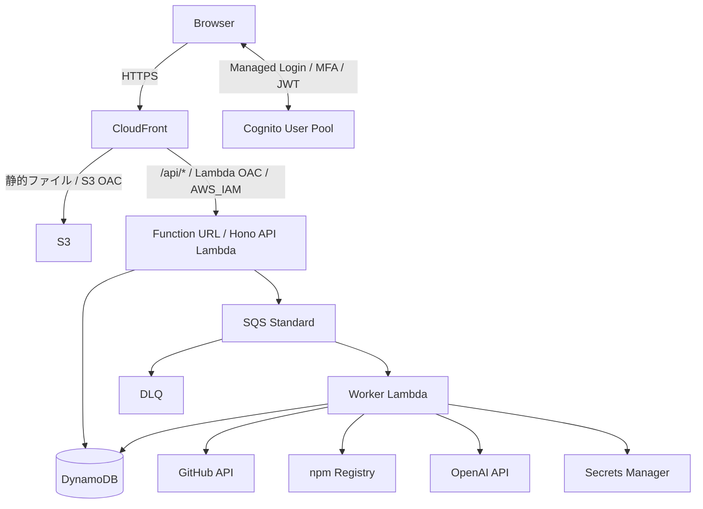

# アーキテクチャ

## AWS構成

S3とLambda Function URLの両方にCloudFront OACを設定する。Function URLは `AWS_IAM` 認証とし、CloudFrontを経由しない直接アクセスを拒否する。ブラウザーは同一オリジンの `/api/...` にアクセスする。

Cognito JWTとCloudFrontのSigV4署名の扱いは[セキュリティ要件](security.md)、リソース構築は[インフラ・運用](infra/terraform.md)を参照する。

## 監査の流れ

1. ユーザーがCognitoでログインする。
2. 公開GitHubリポジトリURLを入力し、Reactが監査開始APIを呼ぶ。
3. APIがJWT、許可ユーザー、入力、利用回数を検証する。
4. DynamoDBに `PENDING` ジョブを作り、SQSにジョブIDを送る。
5. APIは `202 Accepted` を返す。
6. Worker Lambdaがジョブと実行権限を確認し、実行ロックを取得する。
7. GitHub APIからデフォルトブランチの最新コミットSHAを特定し、そのSHAの対象ファイルを取得する。
8. `npm audit` を実行し、監査結果を正規化する。
9. 正規化結果をOpenAI APIで分析し、構造化レポートを検証する。
10. DynamoDBへ結果を保存し、ジョブを `COMPLETED` にする。処理失敗は `FAILED` とする。
11. Reactがポーリングで完了・失敗を検出し、結果を表示する。

バックエンドからのプッシュ通知は実装しない。脆弱性検出は処理失敗と区別する。

## ローカル構成と役割

Ubuntuホスト上でVS CodeとCodexを動かし、リポジトリルートを単一ワークスペースとして開く。編集、Git、npm依存管理、型チェック、ESLint、単体テスト、Terraformはホストで行う。

ComposeではFrontend・API・DynamoDB Localを常時起動し、Workerは必要時のみ起動する。Frontend・API・Workerはリポジトリ全体を `/workspace` にbind mountし、ソースとホストのルート `node_modules` を共有する。

| モード | DynamoDB | SQS | Worker | Cognito |
|---|---|---|---|---|
| Local Mock（Phase 1実装済み） | Local | DynamoDB実行スロットを使うモック | API内のモック / Compose CLI | localhost限定の初期認証例外 |
| Local Audit | Local | 不使用 | Composeから処理本体を直接実行 | dev User Pool |
| AWS Dev | AWS | AWS | Lambda | dev User Pool |
| AWS Prod | AWS | AWS | Lambda | prod User Pool |

Phase 1の実装・検証範囲は[確定仕様](spec/local-basic.md)を参照する。Local Audit・AWS構成・Cognitoは未実装。

ローカルにSQSエミュレーターは導入しない。初期Phase 1のlocalhost限定認証例外は[開発ワークフロー](dev/workflow.md)に従う。

API呼び出しは常に相対パス `/api/...` を使う。ローカルはVite Proxyが `http://api:3000` に転送し、AWSはCloudFrontがFunction URLへ転送する。

## 実行環境との境界

- Honoアプリの定義と、ローカルHTTPサーバー・Lambdaエントリーポイントを分ける。
- Workerの処理本体を `runAudit(jobId, ownerSub)` とし、Lambda/SQSイベントに依存させない。
- ローカルWorkerエントリーポイントとLambdaハンドラーから同じ処理本体を呼ぶ。
- 環境非依存の型・Zodスキーマは `packages/core` に置く。
- AWS SDKを利用するDynamoDB・SQS実装は `packages/aws` に置く。
- ローカルのSQS・AIモックを用意し、アプリロジックをAWS全体の再現に依存させない。

ローカル開発環境の変更はAWSアーキテクチャを変更しない。開発コンテナ自体はAWSへデプロイせず、静的ファイルとLambda向け成果物をクリーンビルドする。
