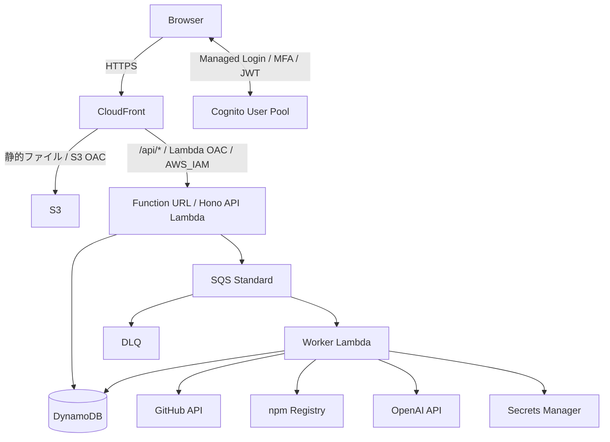
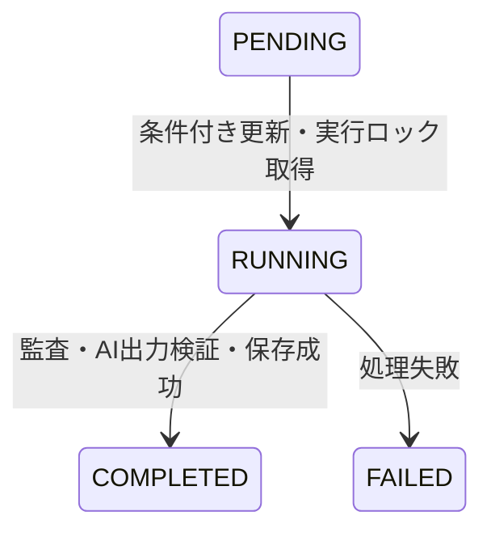

# Repo Sentinel — PoC実装計画

**状態:** 未実装の計画・要件（実装済み仕様ではない）
**統合日:** 2026-11-01

本書はPoCの実装目標をまとめる。旧 `docs/spec/` のFrontend・API・データ・Worker・AIの5文書と、旧基本仕様書 v0.1.0・ローカル開発環境変更要件書 v1.0.0を統合した。旧原文2本は末尾の対応表で網羅性を確認して廃止した。

ユーザーの明示的な指示を優先する。原文同士の競合は変更要件を優先して解消済み。現行の `frontend/app`・`api/app`・`workers/security-audit/app` と `docker-compose.yaml` を維持する。

`docs/spec/` は実装・検証され、確定した仕様の記録先とする。本計画の採用方針・例示コード・未確定項目を実装済み仕様として扱わない。現在は空のDockerfile・Composeなどの雛形で、npm設定・アプリ・Terraform・テストは未実装。記載コマンドは環境構築後の実行目標である。

詳細な作業ガイドは [docs/README.md](../README.md)、未確定事項の管理は [decisions.md](../decisions.md) を参照する。計画の要求を変える場合は本書と関係する作業ガイドを同時に更新する。

## 目次

- [目的・範囲・技術](#overview)
- [システム構成](#architecture)
- [フロントエンド](#frontend)
- [API](#api)
- [データ設計](#data-model)
- [Worker・機械監査](#worker)
- [AIレポート](#ai-report)
- [セキュリティ・費用制限](#security)
- [ローカル開発計画](#local-development)
- [インフラ・運用計画](#infrastructure)
- [実装手順・日常開発](#workflow)
- [検証・受け入れ条件](#acceptance)
- [未確定事項](#open-questions)
- [統合時の網羅性確認](#coverage)

<a id="overview"></a>

## 目的・範囲・技術

### 目的

Repo Sentinel（基本仕様書名：GitHub Security Audit PoC）は、公開GitHubリポジトリのnpm依存関係を機械的に監査し、OpenAI APIで人間が理解しやすいセキュリティレポートを生成するWebアプリケーションである。

監査からAIレポート生成までの一連の動作と、AWS上での安全な非同期処理を検証する。将来のSaaS化は想定するが、初期PoCは管理者が作成した1ユーザーによる個人利用に限定する。

### 初期PoCの範囲

- ユーザー操作で監査を開始する。
- 公開GitHubリポジトリのデフォルトブランチ最新コミットを対象とする。
- ルートの `package.json` と `package-lock.json` を取得する。
- `npm audit` で依存関係を監査し、結果を正規化する。
- AIは監査結果の分析とレポート生成のみを行う。
- APIとWorkerを分離し、AWSではSQSで非同期実行する。
- DynamoDBに状態・履歴・結果を保存し、画面からポーリングする。
- Cognito認証、利用ユーザー制限、実行回数・費用制限を実装する。
- アプリケーションロジックをローカルとAWSで共通化する。
- AWSインフラはTerraformで管理する。

### 初期PoCで実装しないもの

- npm以外のエコシステム、複数種類の機械監査。
- GitHub App・GitHub OAuth・プライベートリポジトリへのアクセス。
- モノレポ内の個別ワークスペース指定。
- 外部リポジトリの任意コード実行。
- AIによる監査ロジックの動的生成、インターネット検索、追加ツール利用、コード修正。
- 定期実行、Slack・メール通知、その他の外部連携。
- 複数ユーザー管理、課金・契約管理、SBOM生成・保存。

### 採用技術

| 分野 | 技術 |
|---|---|
| 言語・共通契約 | TypeScript、Zod |
| モノレポ・依存管理 | npm workspaces、単一 `package-lock.json` |
| フロントエンド | React + Vite、CSR |
| API | Hono |
| Node.js | AWS Lambda対応LTS。ホストと開発コンテナで同一バージョン |
| 静的配信 | CloudFront + S3 |
| API公開・実行 | Lambda Function URL + CloudFront OAC、Lambda |
| 非同期処理 | SQS Standard、Worker Lambda |
| データベース | DynamoDB、ローカルはDynamoDB Local |
| 認証 | Cognito User Pool、パスワード + TOTP MFA |
| 監査 | npm audit |
| AI | OpenAI Responses API、Structured Outputs |
| 秘密情報 | Secrets Manager |
| ログ・監視 | CloudWatch、AWS Budgets |
| IaC | Terraform |
| 開発環境 | UbuntuホストのVS Code + Codex、Docker Compose |

アプリケーションロジックはTypeScriptで統一し、Python、Go、ECS、Step Functionsは導入しない。Node.jsの確定バージョンは[未確定事項](../decisions.md)で扱う。

### 設計原則

1. 小さく実装し、PoCに不要な抽象化やサービスを導入しない。
2. ビジネスロジックをLambda・SQS・Dockerの実行環境から分離する。
3. 外部リポジトリはデータとして読み、信頼できないコードを実行しない。
4. 認証・IAM最小権限・秘密情報管理・費用制限を初期から設計する。段階導入時の例外は[開発ワークフロー](../dev/workflow.md)に限定する。
5. npm workspacesと単一ロックファイルで依存関係を一元管理する。
6. ホストの単一ワークスペースから編集・検証・実行操作を行う。
7. インフラを宣言的に管理し、手動設定への依存を最小化する。
8. ローカルではアプリロジック、AWS devではAWS固有の連携を検証する。

### 将来の検討候補

GitHub App連携、npm以外への対応、複数の機械監査、AIによる監査プロファイル生成・セキュリティニュース調査、EventBridge定期実行、監査結果の差分検出、Slack・メール通知、マルチテナント、Stripe月額課金、監査結果のS3保存、コード・CI/CD・IaCの横断監査を候補とする。いずれも現段階では実装しない。

<a id="architecture"></a>

## システム構成

### AWS構成



S3とLambda Function URLの両方にCloudFront OACを設定する。Function URLは `AWS_IAM` 認証とし、CloudFrontを経由しない直接アクセスを拒否する。ブラウザーは同一オリジンの `/api/...` にアクセスする。

Cognito JWTとCloudFrontのSigV4署名の扱いは[セキュリティ要件](../security.md)、リソース構築は[インフラ・運用](../infra/terraform.md)を参照する。

### 監査の流れ

1. ユーザーがCognitoでログインする。
2. 公開GitHubリポジトリURLを入力し、Reactが監査開始APIを呼ぶ。
3. APIがJWT、許可ユーザー、入力、利用回数を検証する。
4. DynamoDBに `PENDING` ジョブを作り、SQSにジョブIDを送る。
5. APIは `202 Accepted` を返す。
6. Worker Lambdaがジョブと実行権限を確認し、実行ロックを取得する。
7. GitHub APIからデフォルトブランチの最新コミットSHAを特定し、そのSHAの対象ファイルを取得する。
8. `npm audit` を実行し、監査結果を正規化する。
9. 正規化結果をOpenAI APIで分析し、構造化レポートを検証する。
10. DynamoDBへ結果を保存し、ジョブを `COMPLETED` にする。処理失敗は `FAILED` とする。
11. Reactがポーリングで完了・失敗を検出し、結果を表示する。

バックエンドからのプッシュ通知は実装しない。脆弱性検出は処理失敗と区別する。

### ローカル構成と役割

Ubuntuホスト上でVS CodeとCodexを動かし、リポジトリルートを単一ワークスペースとして開く。編集、Git、npm依存管理、型チェック、ESLint、単体テスト、Terraformはホストで行う。

ComposeではFrontend・API・DynamoDB Localを常時起動し、Workerは必要時のみ起動する。Frontend・API・Workerはリポジトリ全体を `/workspace` にbind mountし、ソースとホストのルート `node_modules` を共有する。

| モード | DynamoDB | SQS | Worker | Cognito |
|---|---|---|---|---|
| Local Mock | Local | モック | モック | dev User Pool |
| Local Audit | Local | 不使用 | Composeから処理本体を直接実行 | dev User Pool |
| AWS Dev | AWS | AWS | Lambda | dev User Pool |
| AWS Prod | AWS | AWS | Lambda | prod User Pool |

ローカルにSQSエミュレーターは導入しない。初期Phase 1のlocalhost限定認証例外は[開発ワークフロー](../dev/workflow.md)に従う。

API呼び出しは常に相対パス `/api/...` を使う。ローカルはVite Proxyが `http://api:3000` に転送し、AWSはCloudFrontがFunction URLへ転送する。

### 実行環境との境界

- Honoアプリの定義と、ローカルHTTPサーバー・Lambdaエントリーポイントを分ける。
- Workerの処理本体を `runAudit(jobId, ownerSub)` とし、Lambda/SQSイベントに依存させない。
- ローカルWorkerエントリーポイントとLambdaハンドラーから同じ処理本体を呼ぶ。
- 環境非依存の型・Zodスキーマは `packages/core` に置く。
- AWS SDKを利用するDynamoDB・SQS実装は `packages/aws` に置く。
- ローカルのSQS・AIモックを用意し、アプリロジックをAWS全体の再現に依存させない。

ローカル開発環境の変更はAWSアーキテクチャを変更しない。開発コンテナ自体はAWSへデプロイせず、静的ファイルとLambda向け成果物をクリーンビルドする。

<a id="frontend"></a>

## フロントエンド

React + ViteのCSRアプリケーションとする。配置先は `frontend/app`。認証の詳細は[セキュリティ要件](#security)を参照する。

### 画面

| 画面 | 必須内容 |
|---|---|
| 監査開始 | GitHubリポジトリURL入力、監査開始ボタン、入力値検証、実行中ジョブ表示 |
| 監査履歴 | 監査日時、リポジトリ名、状態、検出件数、詳細への遷移 |
| 監査結果 | 処理状態、対象コミット、脆弱性件数、深刻度別サマリー、AIレポート、監査エラー |

画面URL、履歴のページング、詳細の全レスポンス契約は[未確定事項](../decisions.md)で確定する。

### 監査開始

- 入力対象は `https://github.com/{owner}/{repository}` 形式の公開リポジトリ。
- デフォルトブランチ最新コミットとルートのnpmマニフェスト・ロックファイルのみ対象とする。
- クライアント側の入力検証を行い、サーバー側でも同じ共有スキーマで検証する。
- `POST /api/audits` の `202 Accepted` と `jobId` を受け、状態取得を開始する。
- 実行中ジョブを表示する。利用上限や失敗はAPI契約に沿って表示する。

APIの要求・応答は [API仕様](#api)、データと状態は[データ設計](#data-model)に従う。

### ポーリング

- `GET /api/audits/:id` を2〜3秒間隔で取得する。
- `PENDING` / `RUNNING` 中の状態を表示する。
- `COMPLETED` または `FAILED` で停止する。
- 画面を離れた場合も停止する。

バックエンドからのプッシュ通知は使用しない。通信失敗時の再試行・停止条件は[未確定事項](../decisions.md)で定義する。

### 結果表示

脆弱性が見つかった場合も、処理が成功していれば `COMPLETED` として表示する。脆弱性の有無と処理の成否を混同しない。

機械監査の検出結果とAIが生成した説明を区別する。対象コミット、監査日時、深刻度別件数をレポートの根拠として確認できるようにする。AIの限界・注意事項も表示する。

### 認証とAPI通信

- Cognito Managed Login、Authorization Code Flow + PKCEを使う。
- パスワード + TOTP MFAでログインする。
- トークンは可能な限りメモリ上に保持し、永続ストレージへの保存を避ける。
- APIは相対パス `/api/...` で呼ぶ。
- AWSではCloudFrontのSigV4署名用Authorizationと競合しないJWT専用ヘッダーを使う。
- POSTには `x-amz-content-sha256` を設定する。最終ヘッダー契約は[API仕様](#api)で管理する。

ローカルはVite Proxy、AWSはCloudFront経由で同じAPIパスを利用する。Vite設定は[ローカル開発](../dev/local-development.md)を参照する。

<a id="api"></a>

## API

APIはHonoで実装し、ベースパスを `/api` とする。配置先は `api/app`。ローカルサーバーとLambdaエントリーポイントを分け、同じアプリ定義を使用する。

### 共通契約

- 全APIにCognito JWT検証と許可ユーザー認可を適用する。
- 認証の検証項目は[セキュリティ要件](#security)に従う。
- 要求・応答はZodで定義し、`packages/core` を通じてFrontend・APIで共有する。
- 監査対象URLと `owner/repo` を検証し、任意URLのバックエンド取得を認めない。
- 対象ユーザーは検証済みJWTの `sub` を基準に扱う。

CloudFrontはFunction URLへSigV4署名するため、JWTは `X-Access-Token` などの専用ヘッダーで転送する。POSTは `x-amz-content-sha256` を設定する。専用ヘッダー名の確定、ボディハッシュの生成、CloudFront転送ポリシーの整合は実装前に[未確定事項](../decisions.md)を解消する。

### エンドポイント

| Method | Path | 用途 |
|---|---|---|
| POST | `/api/audits` | 監査ジョブ作成 |
| GET | `/api/audits` | 監査履歴取得 |
| GET | `/api/audits/:id` | 状態・結果取得 |

### 監査ジョブ作成

`POST /api/audits`

```json
{
  "repositoryUrl": "https://github.com/example/project"
}
```

処理順序：

1. JWTと許可ユーザーを検証する。
2. 入力URLを検証する。
3. 実行回数制限を検証する。同時リクエストで上限を突破できないようにする。
4. DynamoDBに `PENDING` ジョブを作る。
5. SQSへジョブIDを送る。ローカルはモックに置き換える。
6. `202 Accepted` を返す。

```json
{
  "jobId": "01EXAMPLE...",
  "status": "PENDING"
}
```

同時監査の実行ロックと回数制限の整合は[データ設計](#data-model)に従う。ジョブ保存とキュー送信の片方だけが成功した場合の処理は未確定。

### 監査履歴取得

`GET /api/audits`

認可されたユーザーの監査履歴を返す。画面には監査日時、リポジトリ名、状態、検出件数、詳細への遷移情報が必要。DynamoDBのULIDを利用し時系列で取得する。

要求クエリー、並び順、ページサイズ、継続トークン、応答エンベロープは原文に定義されていない。Zod契約の確定前に[未確定事項](../decisions.md)で決める。

### ジョブ状態・結果取得

`GET /api/audits/:id`

基本仕様の完了時レスポンス例：

```json
{
  "jobId": "01EXAMPLE...",
  "repository": "example/project",
  "status": "COMPLETED",
  "createdAt": "2026-11-01T01:00:00Z",
  "finishedAt": "2026-11-01T01:00:35Z",
  "summary": {
    "critical": 0,
    "high": 2,
    "moderate": 3,
    "low": 1
  },
  "report": {
    "overallAssessment": "...",
    "summary": "...",
    "priorities": [],
    "recommendations": [],
    "limitations": []
  }
}
```

例は完全な確定スキーマではない。結果画面で必要な `commitSha`、想定影響の表現、`findings` の公開範囲、処理中・失敗時のフィールド有無を正式なZod契約で定義する。AIレポートの要件は[AIレポート仕様](#ai-report)を参照する。

### エラー・制限

未認証、未許可ユーザー、不正入力、利用上限、対象ジョブなし、キュー送信失敗などを扱う。HTTPステータス、エラー応答形式、具体的なコードは未定義であり、実装時に契約として定義する。

日次上限・同時実行制限をFrontendの制御だけに依存させない。APIキャッシュはCloudFrontで無効化する。初期Phase 1以外の認証例外を作らない。

<a id="data-model"></a>

## データ設計

### DynamoDBテーブル

初期PoCは1テーブルとし、ジョブ管理用メタデータも同じテーブルへ格納する。テーブル名の例は `security-audit-jobs-{environment}`。dev/prodは別テーブルにする。

```text
PK = USER#{sub}
SK = AUDIT#{ULID}
```

検証済みCognito `sub` でユーザーを識別し、ULIDで監査履歴を時系列に取得する。AWS SDK実装は `packages/aws` に置き、ローカルはDynamoDB Localへ接続する。

### ジョブ属性

| 属性 | 内容 |
|---|---|
| `jobId` | ジョブID（ULID） |
| `repository` | `owner/repo` |
| `commitSha` | 監査対象の確定コミット |
| `status` | `PENDING` / `RUNNING` / `COMPLETED` / `FAILED` |
| `createdAt` | 作成日時 |
| `startedAt` | 実行開始日時 |
| `finishedAt` | 処理終了日時 |
| `attemptCount` | 実行試行回数 |
| `summary` | 深刻度別の検出件数 |
| `findings` | 正規化した機械監査結果 |
| `report` | 検証済みAIレポート |
| `errorCode` | 処理失敗理由 |
| `expiresAt` | 任意の保存期限 |

状態ごとの必須・任意属性、正規化結果・レポートの正式型はZodで定義する。API公開型と保存型の境界も確定する。

保存データがDynamoDBアイテムサイズ上限を超える場合、初期PoCはエラーとして扱う。結果のS3分離は将来拡張とし、初期PoCでは実装しない。

### 状態遷移



脆弱性が検出されても、監査処理が成功していれば `COMPLETED` とする。脆弱性の有無とジョブの実行成否を分離する。

上図は原文で定義された通常の遷移。キュー送信失敗、ロック競合、期限切れリースなどの遷移は[未確定事項](../decisions.md)で設計する。

### 冪等性と実行リース

- SQS Standardは重複配信を前提とする。
- WorkerはDynamoDB条件付き更新により、`PENDING` → `RUNNING` に成功した場合のみ処理を開始する。
- 実行中ジョブにリース期限を持たせ、タイムアウトした処理を検出できるようにする。
- `COMPLETED` のジョブは再処理しない。
- 有料AI処理を最大1件に制限するアプリケーション側ジョブロックを設ける。
- 外部API呼び出しの完全な重複排除は保証できない。OpenAI呼び出し後の成否が不確実な失敗は、自動再実行を抑制する。

ジョブ状態の条件付き更新だけでは、複数の異なるジョブの同時AI実行を制限できない。全体ロック、リース、所有者確認、解放条件の具体形を設計する必要がある。WorkerのReserved Concurrencyは[Worker仕様](#worker)の設定に従う。

### 利用回数・管理メタデータ

監査開始の初期上限は[セキュリティ要件](#security)を正とする。日次回数などのメタデータを同じテーブルに置き、条件付き更新などで並列リクエストによる上限突破を防ぐ。

以下は原文に詳細がなく、実装前に確定する。

- メタデータのキー・属性、回数判定の日付境界。
- ジョブ作成と回数消費・ロックの原子性、失敗時の回数扱い。
- リース属性名・期間・更新方法、期限切れ検出と復旧。
- `attemptCount` の増加条件、AI実行前後の記録。
- Workerへの `ownerSub` の受け渡し、ローカルCLIでの所有者解決。
- 保存期限を使うかと、その保持期間・TTL設定。

これらの決定は[未確定事項](../decisions.md)と本書へ反映する。

<a id="worker"></a>

## Worker・機械監査

### 処理本体とエントリーポイント

配置先は `workers/security-audit/app`。処理本体をLambdaに依存しない関数として実装する。

```typescript
async function runAudit(
  jobId: string,
  ownerSub: string
): Promise<void>
```

LambdaハンドラーはSQSイベントを処理本体へ変換し、ローカルエントリーポイントも同じ関数を呼ぶ。AWS固有のイベントを処理本体へ持ち込まない。

処理順序：

1. ジョブ取得。
2. 実行権限・所有者・状態の確認。
3. 実行ロック取得と条件付き状態更新。
4. GitHubから監査対象ファイル取得。
5. `npm audit` 実行。
6. 監査結果の正規化。
7. OpenAI API呼び出しと出力検証。
8. レポート保存。
9. ジョブ完了処理。

各処理に明示的なタイムアウトを設定する。状態・ロック・リースは[データ設計](#data-model)、AIは[AIレポート仕様](#ai-report)に従う。

### GitHubリポジトリの指定

入力形式：

```text
https://github.com/{owner}/{repository}
```

- 公開リポジトリのみ対象とする。
- GitHub APIでデフォルトブランチと最新コミットSHAを取得する。
- 取得したSHAのルート `package.json` と `package-lock.json` のみを監査する。
- ファイル取得時に同じSHAを使い、対象コミットを結果へ保存する。
- モノレポ内の個別ワークスペース、任意ブランチ・コミット指定には対応しない。
- GitHub以外の任意URLをバックエンドで取得しない。

`owner/repo` を検証し、各ファイルサイズと取得時間に上限を設定する。具体値、欠損・非対応lockfileの扱い、GitHub API認証方法は[未確定事項](../decisions.md)で確定する。

### npm audit

対象の2ファイルを一時ディレクトリに配置し、次を実行する。

```bash
npm audit --json --package-lock-only
```

監査対象リポジトリの依存パッケージはインストールしない。対象に対する `npm install`、`npm audit fix`、`npm run`、npmスクリプト、任意コード実行は禁止する。この制約は開発用workspace自身への依存追加とは区別する。

実行上の制約：

- 監査対象のnpm設定ファイルを実行環境へ適用しない。
- npm Registry接続先を固定する。
- 子プロセス実行にシェル展開を使わない。
- 実行時間・コマンド出力サイズに上限を設ける。
- 処理後は一時ファイルを削除する。
- 外部リポジトリの内容を信頼しない。

### 終了コードとエラー判定

脆弱性があると `npm audit` は正常なJSONを生成しても非ゼロ終了になる。終了コードだけで失敗と判定せず、JSON出力を解析する。

JSON生成・解析失敗、タイムアウト、npm Registry通信失敗などは監査エラーとする。監査成功で脆弱性が検出された場合は `COMPLETED` にできる。機械監査失敗時に根拠のないAIレポートを作らない。

### 正規化して保存する情報

- 依存パッケージ名。
- 検出された脆弱性。
- 深刻度。
- 影響を受けるバージョン。
- 修正可能性。
- アドバイザリ参照URL。
- 深刻度別の検出件数。

必要な情報へ正規化し、保存サイズを制限する。サマリー例の `critical` / `high` / `moderate` / `low` 以外の深刻度が出現する場合の扱いは、正式スキーマで決める。

### SQS・Lambda初期設定

| 項目 | 設定 |
|---|---|
| Queue Type | Standard |
| Batch Size | 1 |
| Worker Timeout | 180秒 |
| Visibility Timeout | 1,080秒 |
| DLQ | 有効 |
| `maxReceiveCount` | 2〜3（実装時に確定） |
| 同時監査ジョブ数 | 1件 |
| Worker Reserved Concurrency | 初期値2 |

Visibility TimeoutはWorker Timeoutの6倍を基準とする。Event Source Mappingの最大並列度を設定する場合はLambda設定と整合させる。

LambdaのReserved Concurrencyとは別に、アプリケーション側ジョブロックで有料AI処理を最大1件へ制限する。重複配信やリース切れを理由にAIを無制限に再試行しない。

SQSメッセージはジョブIDを送る要件がある一方、処理本体は `ownerSub` も必要とする。メッセージの完全なスキーマと所有者の解決方式は未確定。失敗の種類ごとのメッセージ再試行・削除・DLQ移動条件も定義する。

### ローカル実行

SQSを経由せず、ホストから次を実行する。

```bash
docker compose run --rm worker \
  npm run audit:local -w workers/security-audit/app -- <job-id>
```

実GitHub・npm Registry・OpenAIへ接続するLocal Auditと、AIを呼ばないモックモードを用意する。Frontend開発と単体テストはモックを使う。DynamoDBはDynamoDB Localを使う。CLIと秘密情報注入の前提は[ローカル開発](../dev/local-development.md)を参照する。

<a id="ai-report"></a>

## AIレポート

### 役割

OpenAI Responses APIを使用し、機械監査結果を分析して人間向けのレポートを生成する。AIに監査ロジックの生成、インターネット検索、追加ツール利用、コード修正をさせない。

呼び出しはWorkerから行う。モデル名・プロンプト・出力トークン上限はサーバー側で固定し、クライアントから選ばせない。

### 入力

入力は次に限定する。

- リポジトリ識別子。
- 監査対象コミットSHA。
- 監査日時。
- 正規化したnpm audit結果。
- 深刻度別件数。

リポジトリ内の任意コードや、監査に不要な内容を入力へ追加しない。入力サイズには上限を設定する。具体的な上限とモデルは[未確定事項](../decisions.md)で確定する。

### 出力内容

| 内容 | 目的 |
|---|---|
| 総合評価 | 監査結果全体の説明 |
| 検出された問題の概要 | 機械監査結果の要約 |
| 優先的に確認すべき問題 | 確認優先度の提示 |
| 想定される影響 | 与えられた事実に基づく影響説明 |
| 推奨される対応 | 対応方針の提示 |
| 監査の限界・注意事項 | 判断の範囲と制約の明示 |

Structured Outputsを使用し、JSON Schemaに準拠した出力を取得する。保存前に共有スキーマで検証する。

基本仕様の例には `overallAssessment`、`summary`、`priorities`、`recommendations`、`limitations` があるが、想定影響の配置や配列要素型は定義されていない。6つの内容を満たす完全なスキーマを定義してからAPI・画面へ共有する。

### 事実とAI説明の区別

- 機械監査の検出結果・件数と、AIの説明・推論を区別する。
- 入力に根拠のないCVE番号、修正バージョン、検出結果を新たに生成させない。
- プロンプトと検証処理の両方で根拠のない追加情報を抑制する。
- 監査の限界・注意事項をレポートに含める。
- JSON Schemaへの適合と、内容の事実整合性は別に検証する。

事実整合性の具体的な照合方式や、拒否・不完全出力時のエラーコードは未確定。

### 費用・失敗・重複

AI呼び出しは原則1回/ジョブとし、失敗時に無制限に再試行しない。入力・出力・実行時間・日次回数・同時実行・月次支出の制限は[セキュリティ要件](#security)に従う。

OpenAI呼び出し成功後にWorkerが停止した場合など、外部APIの完全な重複排除はできない。成否が不確実な失敗は自動再実行を抑制する。SQSの再配信とAI呼び出しの再試行を同一視しない。

APIキーはWorkerだけがアクセスし、AWSではSecrets Managerに保存する。Terraform Stateへ値を格納しない。ローカルはGit管理外の環境変数などから注入する。

### 開発・検証

AIを呼ばないモックモードを用意し、Frontend開発と単体テストに使用する。実AI接続前に機械監査と正規化を検証する。プロンプト変更はローカルで検証し、実呼び出しを行う場合も利用制限を適用する。

検証対象は構造適合、6つの内容、事実との整合、入力サイズ、出力上限、失敗・タイムアウト、重複呼び出し抑制とする。

<a id="security"></a>

## セキュリティ・費用制限

本書は認証・外部入力・秘密情報・費用制限の基準を定める。ローカル開発環境の変更によってこれらの要件を緩和しない。

### Cognito認証とユーザー認可

- Cognito User Poolの自己登録を禁止する。
- 管理者が作成した1ユーザーのみ利用する。
- パスワード認証とTOTP MFAを必須にする。
- Managed LoginとAuthorization Code Flow + PKCEを使用する。
- Googleなどの外部IdPは利用しない。
- devとprodでUser Poolを分ける。ローカルはdevを利用する。

HonoはAPIリクエストごとにJWTを検証する。

| 検証項目 | 要件 |
|---|---|
| 署名 | 正しい署名であること |
| Issuer | 対象User PoolのIssuerと一致 |
| 有効期限 | 有効期間内 |
| Token Use | 採用するトークン用途に一致 |
| Client ID | 対象App Clientと一致 |
| `sub` | 許可済みユーザーの `sub` と一致 |

ログイン済みでも許可 `sub` と一致しなければ拒否する。JWTを検証できない場合も拒否する。Token Useの具体値と対応claimは[未確定事項](../decisions.md)で確定する。

Frontendはトークンを可能な限りメモリに保持し、永続ストレージ保存を避ける。認証バイパスは初期実装時のlocalhost限定とし、Cognito導入後はローカルでも実認証を基本とする。AWS dev/prodに認証バイパスを入れない。

### CloudFront・Lambda・S3

- S3 Block Public AccessとS3 OACを有効にする。
- Function URLは `AWS_IAM` 認証とする。
- Lambda用CloudFront OACとリソースポリシーで、CloudFrontを経由しない直接アクセスを拒否する。
- APIは同一オリジンの `/api/*` で公開し、キャッシュを無効にする。
- CloudFrontからのオリジンアクセスを適切に制限する。
- LambdaのIAMロールは最小権限とする。

CloudFrontがFunction URLへSigV4署名するため、JWTは `X-Access-Token` などの専用ヘッダーで転送する。POSTは `x-amz-content-sha256` を設定する。最終的なヘッダー・転送契約は[API仕様](#api)で管理する。

### 外部リポジトリ・子プロセス

公開リポジトリの内容も信頼しない。

- GitHub以外の任意URLを禁止し、`owner/repo` 形式を検証する。
- 取得ファイルサイズと取得時間を制限する。
- 対象のnpm設定を実行環境に適用しない。
- 監査対象のパッケージインストール、npmスクリプト、任意コード実行を禁止する。
- `npm audit fix` などの対象変更を行わない。
- 子プロセスにシェル展開を使わない。
- npm Registry接続先を固定する。
- コマンド出力サイズと実行時間を制限する。
- 一時ファイルを処理後に削除する。

監査コマンドとエラー判定は[Worker仕様](#worker)を参照する。具体的なサイズ・時間・接続先の設定値は[未確定事項](../decisions.md)で確定する。

### OpenAI APIとアプリケーションの初期制限

| 項目 | 初期上限・方針 |
|---|---|
| 監査開始 | 5回/日 |
| 同時監査 | 1件 |
| AI呼び出し | 原則1回/ジョブ |
| モデル | サーバー側で固定 |
| 入力サイズ | 上限を設定（値は未確定） |
| 出力トークン | 上限を設定（値は未確定） |
| Worker実行時間 | 180秒 |
| OpenAI月額支出 | 専用Projectで$10を初期上限とする |

統合元の要求はOpenAI Projectの「Hard spend limit」有効化を要求している。この要求は維持するが、利用アカウントで利用可能な強制停止機能・設定方法は本ワークスペースでは未検証。単なる予算通知を強制上限として扱わず、実AI接続前に[未確定事項](../decisions.md)で実現方式を確認する。

原文の前提どおり、外部の支出制限に反映遅延や超過の可能性があるものとして、アプリケーション側でも利用を制限する。DynamoDBの条件付き更新などで日次回数を管理し、同時リクエストで突破できないようにする。

OpenAI API失敗時に無制限に再試行しない。AI呼び出し後の成否が不確実な失敗は自動再実行を抑制する。[データ設計](#data-model)の冪等性と合わせて実装する。

AWS Budgetsも設定するが、請求アラートだけを費用制限手段にしない。

### 秘密情報とIAM

- OpenAI APIキーはWorkerのみがアクセス可能にする。
- AWSではSecrets Managerに保存し、Terraform Stateへキー値を格納しない。
- dev/prodでOpenAI APIキーを分ける。
- ローカル実API用秘密情報はGit管理外の環境変数ファイルなどから注入する。
- API・WorkerのIAMロールは役割に必要な権限へ限定する。
- Codexが利用するAWS認証情報は開発用の最小権限へ限定する。

IAM変更・Secrets Manager更新などの確認要件は[開発ワークフロー](../dev/workflow.md)を参照する。

### ログと監視

ログへアクセストークン、APIキー、認証ヘッダー、不要なリポジトリ内容を記録しない。CloudWatchでAPIエラー、Workerエラー・タイムアウト、SQS滞留、DLQ件数、ジョブ異常終了、OpenAI APIエラーを監視する。

リソースと運用上の確認は[インフラ・運用](../infra/terraform.md)、攻撃・障害ケースの検証は[検証計画](../testing.md)を参照する。

<a id="local-development"></a>

## ローカル開発計画

### 配置とworkspace

既存のサービスディレクトリとその `app/`、`packages/core`、`packages/aws`、`infra/`、Dockerfile、ルート `docker-compose.yaml` を維持する。ファイル移動は不要。アプリの `src/` と `package.json` は各 `app/` に配置する。

ルートの `package.json` は `private: true` とし、次のworkspaceを定義する。

```json
{
  "name": "repo-sentinel",
  "private": true,
  "workspaces": [
    "frontend/app",
    "api/app",
    "workers/security-audit/app",
    "packages/*"
  ]
}
```

各workspaceが必要な依存関係を宣言する。`packages/core` は環境非依存の型・Zodスキーマ、`packages/aws` はAWS SDKによるDynamoDB・SQS実装を置く。共通パッケージは最小限にする。詳細なファイル配置は[リポジトリ構成](../dev/repository.md)を参照する。

### ホスト・依存関係

- UbuntuホストでVS Code + Codex拡張を起動し、モノレポルートを単一ワークスペースとして開く。
- 編集、コード生成、Git、npm依存管理、型チェック、ESLint、単体テスト、Terraformはホストで行う。
- Node.jsはホストのfnmで切り替え、`.node-version` で固定する。公式コンテナイメージと可能な限りパッチまで一致させ、CPUアーキテクチャも一致させる。
- npm workspacesを維持し、ロックファイルはルートの `package-lock.json` 1本にする。
- ホストで `npm ci` を実行する。初期構築時は先にworkspace定義と整合するロックファイルを作る。
- ホストのルート `node_modules` をソースと共に共有する。通常は名前付きVolumeで分離せず、コンテナ別の依存インストールもしない。
- `node_modules` と秘密情報を含む環境変数ファイルはGit管理外にする。
- Linuxディストリビューションや共有ライブラリの差でネイティブ依存の互換性エラーが出たら、イメージをホストへ近付けるか、例外としてコンテナ側の依存関係を分離し、理由・手順を記録する。共有で全ネイティブモジュールの互換性が保証されるとは扱わない。

### Composeと通信

| サービス | 実行内容 | 起動方式 |
|---|---|---|
| `frontend` | React + Vite | 通常起動 |
| `api` | Hono開発サーバー | 通常起動 |
| `worker` | 監査処理本体の直接実行 | `tools` profile、必要時のみ |
| `dynamodb` | DynamoDB Local | 通常起動 |

- Frontend・API・Workerは `working_dir: /workspace` とし、`./:/workspace` でリポジトリルート全体をbind mountする。`app/` だけのmountにしない。
- 変更要件の `node:24-bookworm-slim` は例示であり、実装時にLambda対応LTSの確定バージョンへ固定する。
- `LOCAL_UID` / `LOCAL_GID` をホストと合わせる。例の既定値は `1000:1000`。Nodeサービスは `init: true` を利用する。
- Frontendはコンテナの `0.0.0.0:5173`、APIは `0.0.0.0:3000` で待ち受け、ホスト公開は `127.0.0.1:5173:5173` と `127.0.0.1:3000:3000` に限定する。
- API・WorkerのDynamoDB Local接続先は `http://dynamodb:8000`、例示リージョンは `ap-northeast-1`、ローカル用AWSキー・シークレットはダミーの `local` とする。APIはDynamoDB起動に依存する。
- DynamoDB Localの基本例は `amazon/dynamodb-local:latest`、`-sharedDb -inMemory`。停止後もデータが残る構成ではない。テーブル初期化・永続化は未確定。
- Vite Proxyは `/api` を `http://api:3000` へ `changeOrigin: true` で転送する。Reactは常に相対パス `/api/...` を使い、AWSではCloudFrontが転送する。
- FrontendはVite HMR、APIは `tsx watch` などでホットリロードする。ホストの変更が即時反映されることを必須とする。
- ローカルにSQSエミュレーターを導入しない。SQSはモックし、Workerの処理本体はSQSを介さず直接呼ぶ。
- CognitoはAWS dev User Poolを利用する。導入後はローカルも実認証を基本とし、localhost Callback URLを登録する。
- Workerの実API用秘密情報はGit管理外の環境変数ファイルなどから注入する。
- IDE・Codexをコンテナ内で起動しない。個別のRemote Containers接続は必須とせず、必要な操作はホストから `docker compose exec` / `run` で行う。

Compose・Viteの設定例とセットアップ時の補足は[ローカル開発ガイド](../dev/local-development.md)を参照する。

### ホストから実行するコマンド

以下は構築後の目標。WorkerはホストからCompose経由で実行する。

```bash
npm ci
npm install <package> -w frontend/app
npm install <package> -w api/app
npm install <package> -w workers/security-audit/app
docker compose up -d
docker compose logs -f frontend api
npm run typecheck -w frontend/app
npm run typecheck -w api/app
npm run typecheck -w workers/security-audit/app
docker compose run --rm worker \
  npm run audit:local -w workers/security-audit/app -- <job-id>
docker compose down
```

通常の停止でホストのソースと `node_modules` は削除されない。Local Auditは実GitHub・npm Registry・OpenAI接続を検証できるものとし、Frontend開発・単体テストにはAIを呼ばないモックを用意する。

<a id="infrastructure"></a>

## インフラ・運用計画

### Terraform管理対象

| 領域 | リソース |
|---|---|
| Frontend | S3 Bucket、CloudFront Distribution、S3 OAC |
| API | API Lambda、Function URL、Lambda用OAC、Function URL Resource Policy、API用IAM Role |
| Worker | Worker Lambda、Worker用IAM Role、SQS Event Source Mapping、CloudWatch Log Group |
| Database | DynamoDB Table |
| Queue | SQS Queue、DLQ、Redrive Policy |
| Authentication | Cognito User Pool、App Client、Domain、MFA設定 |
| Security | Secrets Manager Secret、IAM Policies、AWS Budgets |

`infra/terraform/bootstrap/`、`modules/{frontend,api,worker,database,queue,auth}/`、`environments/{dev,prod}/` を配置先の計画とする。既存の `infra/` は維持する。

### 環境分離・State

- dev/prodでTerraform State、Cognito User Pool、DynamoDB Table、SQS Queue、Lambda関数、OpenAI APIキーを分ける。
- 初期はdevだけでもよい。prodはdevで一連の動作が確認できてから構築する。
- S3 Backendを使い、State用Bucketはbootstrap構成で作成する。
- State BucketのVersioningを有効にし、公開アクセスを禁止する。アクセスは管理用IAMへ限定する。
- S3ネイティブロックを使い、DynamoDBによるStateロックは使わない。
- TerraformはSecretリソースを管理するが、OpenAI APIキー値はStateへ格納しない。

### ビルド・配信・監視

FrontendはViteの静的ビルドをCloudFront + S3で配信する。APIはHono + Lambda、WorkerはLambda、キューはSQS、DBはDynamoDB、認証はCognitoのままとし、開発用DockerコンテナをAWSへそのままデプロイしない。

本番向け成果物はクリーン環境の `npm ci` で作り、ホストの `node_modules` を流用しない。API・Workerは対象Lambdaランタイムへ適合する環境で依存関係を再インストールしてパッケージングする。npm auditに必要な実行環境の同梱方式も確定する。

CloudWatchではAPI Lambdaのエラー、Workerエラー・タイムアウト、SQS滞留、DLQ件数、ジョブ異常終了、OpenAI APIエラーを監視する。AWS Budgetsを設定するが、通知だけを費用制限手段としない。ログにアクセストークン、APIキー、認証ヘッダー、不要なリポジトリ内容を残さない。

障害時はジョブ・リース・キュー・ログを照合する。AI呼び出し後の不確実な失敗を無条件に再実行しない。監視閾値、ログ保持、DLQ再投入・異常ジョブ復旧は未確定。[インフラ・運用ガイド](../infra/terraform.md)を参照する。

<a id="workflow"></a>

## 実装手順・日常開発

### 日常の開発

1. [ドキュメント一覧](../README.md)から変更対象の仕様と未確定事項を読む。
2. ホストで実装・依存関係更新・型チェック・ESLint・単体テストを行う。
3. [ローカル開発環境](../dev/local-development.md)のComposeで動作確認する。
4. AWS固有の変更はAWS devへ反映し、統合テストする。
5. 検証結果と未確認事項を記録し、必要に応じてprodへ反映する。

変更内容に応じた検証環境は[検証計画](../testing.md)に従う。初期構築後もローカル環境を維持し、AWS全体をローカルで複製しない。

### Phase 1：ローカルの基本実装

目的：Frontend・API・DynamoDBの基本フローを確認する。

- [現行のディレクトリ構成](../dev/repository.md)を維持し、npm workspacesと単一ロックファイルを初期化する。
- `.node-version`、依存関係共有、Compose、ホストUID/GIDを整える。
- React + Vite、Hono、DynamoDB Localを実装・起動する。
- ジョブモデル、監査作成API、Mock Workerを実装する。
- ポーリングと結果表示を実装する。

この段階では認証と実AI処理を実装しない。認証バイパスはlocalhost限定の初期実装だけに許し、AWS dev/prodでは許さない。

完了条件：監査開始からモックジョブの完了、レポート表示まで動作する。ホスト・Composeの役割分担とホットリロードも[開発環境の受け入れ条件](../testing.md)を満たす。

### Phase 2：Workerのローカル実装

目的：実際の機械監査とAI分析を確認する。

- GitHub API連携、対象SHA・対象ファイル取得。
- `npm audit`、結果正規化。
- OpenAI Responses API、Structured Outputs検証。
- DynamoDBへの保存、タイムアウト・エラー処理。

まずAIをモックして機械監査を検証する。その後、[外部入力・秘密情報・費用制限](#security)を実装したうえで実OpenAI APIを接続する。

完了条件：ホストからCompose経由でWorkerを直接実行し、実公開リポジトリのレポートを生成できる。

### Phase 3：TerraformとCognito

目的：AWS devと認証基盤を準備する。

- Terraform Stateのbootstrapとdev環境定義。
- Cognito User Pool、Managed Login、初期ユーザー、TOTP MFA。
- Reactの認証統合、HonoのJWT検証・許可 `sub` の認可。
- ローカルReactをdev User Poolにつなぎ、localhost Callback URLを登録。

完了条件：許可された本人だけがローカルAPIを利用でき、未認証・未許可アクセスが拒否される。以降はローカルでも実認証を基本とする。

### Phase 4：AWS統合テスト

目的：実AWSサービス間の連携を確認する。

- API・Worker Lambdaのデプロイ、DynamoDBの構築。
- SQS・DLQ・Event Source Mapping。
- CloudFront + S3、Function URL OAC。
- Secrets Manager連携。
- Worker冪等性とOpenAI使用量制限の検証。

完了条件：CloudFrontの画面からAWS Lambdaの監査・レポート生成まで完了する。成果物はクリーン環境でビルドする。

### Phase 5：最終検証・本番化

[検証計画](../testing.md)のセキュリティ・障害・重複・費用制限のケースを完了する。必要に応じてprodを作成する。prodはdevで一連の動作を確認してから作る。

PoC全体の完了は[PoC完了条件](../testing.md)で判定し、個別Phaseの完了と混同しない。

### Codexの操作と権限

Codexはホストからソース作成・変更、npm依存更新、型チェック・ESLint・単体テスト、Compose起動停止・ログ確認、Worker実行、Git操作、Terraform検証・Plan作成を行う。コンテナ内部へCodexをインストールしない。

Dockerデーモンへのアクセスは実質的に高いホスト権限を与え得るため、許可範囲を認識して運用する。AWS認証情報は開発用の最小権限に限定する。

本計画の権限管理として、次の操作は該当操作への明示的な確認を伴う。

- `terraform apply` / `terraform destroy`
- 本番環境へのデプロイ
- AWS IAM権限変更
- Secrets Manager更新
- 本番データ削除

事前に変更内容、Planや成果物、検証結果を確認できる状態にする。検証・Planの作成と、実リソースの変更を区別する。

### 仕様の保守

未実装の要件は本計画を更新し、関係するガイドと[未確定事項](../decisions.md)を整合させる。実装・検証が完了した範囲は [docs/spec/](../spec/README.md) に実際の動作・契約・制約・確認根拠を記録し、本計画にも反映済み範囲を明記する。機能追加・技術選定変更は明示的に管理し、設定例がそのまま動くと記載しない。

<a id="acceptance"></a>

## 検証・受け入れ条件

本文は検証すべき条件であり、現在の合格実績ではない。変更内容に応じて必要なテストを選ぶ。AWS固有の連携は実AWS devで確認する。

### 変更ごとの主な検証環境

| 変更 | 主な環境 |
|---|---|
| UI | ローカル |
| APIロジック | ローカル |
| DynamoDB操作 | DynamoDB Local + AWS dev |
| Worker監査処理 | Composeから直接実行 |
| AIプロンプト | ローカル（基本はモック、必要な実接続も制限下で実行） |
| Cognito | AWS Cognito dev（ローカル画面・APIから接続） |
| SQS・Lambda | AWS dev |
| IAM・CloudFront | AWS dev |
| Terraform | ホストで検証・Plan、AWS devで動作確認 |

型チェック・ESLint・単体テストはホストで実行する。環境構築・コマンドは[ローカル開発](../dev/local-development.md)、段階ごとの完了条件は[開発ワークフロー](../dev/workflow.md)を参照する。

### ローカル開発環境の受け入れ条件

統合元の開発環境の14条件を引き継ぐ。

- [ ] UbuntuホストのVS Codeでモノレポ全体を編集できる。
- [ ] Codex拡張機能からモノレポ全体を参照・変更できる。
- [ ] ホストで `npm ci` を実行できる。
- [ ] FrontendとAPIがComposeで起動する。
- [ ] ホストのソース変更がコンテナへ即時反映される。
- [ ] ReactのHMRが動作する。
- [ ] APIのホットリロードが動作する。
- [ ] ホストでTypeScript型チェックとテストを実行できる。
- [ ] WorkerをComposeから直接実行できる。
- [ ] DynamoDB Localとの通信が動作する。
- [ ] コンテナへの個別IDE接続が不要である。
- [ ] npm workspacesと単一の `package-lock.json` が維持される。
- [ ] ホスト・コンテナ間でファイル所有権の問題が起きない。
- [ ] 本番向けビルドがホストの `node_modules` に依存しない。

### 機能と失敗の検証

| 対象 | 確認事項 |
|---|---|
| 監査開始 | 正常な公開URLで `202` とジョブIDを返し、ジョブが作成される |
| 履歴・詳細 | 対象ユーザーの履歴・状態・コミット・結果が契約どおり取得できる |
| ポーリング | 2〜3秒間隔で取得し、完了・失敗・画面離脱で停止する |
| 対象の固定 | デフォルトブランチの取得済みSHAに対応する2ファイルを使う |
| 機械監査 | 脆弱性ありの非ゼロ終了でも、有効な監査JSONなら処理成功として扱う |
| 実行制約 | 対象の依存インストール・npmスクリプト・任意コードを実行しない |
| 正規化 | 必要な検出情報と深刻度別件数を保存する |
| AI | Schemaに適合し、必須の6内容を持ち、監査にない事実を追加しない |
| モック | 実AIを呼ばずにFrontend・API・Workerのフローを検証できる |
| 保存 | 結果をDynamoDBへ保存し、サイズ超過をエラーとして扱う |

### セキュリティ・障害・重複の最終検証

最終検証フェーズの全項目を含む。

| ケース | 確認する結果 |
|---|---|
| 認証なしのAPIアクセス | 拒否される |
| 許可 `sub` 以外のユーザー | ログイン済みでも拒否される |
| JWT不正・期限切れ・検証失敗 | 拒否される |
| MFA・自己登録 | TOTP必須、自己登録禁止が適用される |
| Function URLへの直接アクセス | CloudFrontを経由しないアクセスが拒否される |
| CloudFront経由のGET/POST | JWT転送、POSTハッシュ、OAC署名が整合し、APIが動く |
| 不正なリポジトリURL | 任意の外部URLを取得せず拒否する |
| 巨大な `package-lock.json` | 設定上限で制限し、制御されたエラーになる |
| npm Registry障害・不正JSON | 監査エラーとして扱う |
| OpenAIタイムアウト・不正出力 | 無制限に再試行せず、状態とエラーを記録する |
| OpenAI利用制限到達 | 設定した利用制限を適用し、画面で失敗を確認できる |
| SQS重複配信 | 条件付き更新・ロックが働き、完了ジョブを再処理しない |
| 異なるジョブの同時実行 | 有料AI処理が最大1件に制限される |
| AI呼び出し直後の停止 | 不確実な成否を無条件に再実行しない |
| Lambdaタイムアウト | 期限切れリースを検出でき、状態を追跡できる |
| DLQ移動 | 設定回数に従ってDLQへ移動し、監視できる |
| DynamoDB状態不整合 | 不整合を検出し、定義した復旧方針に従う |
| 同時リクエストによる回数制限突破 | 条件付き更新などで日次上限を守る |
| 秘密情報 | コード・ログ・Terraform Stateへ漏れない |
| クリーンビルド | ホスト依存を使わず、Lambdaでnpm監査を含めて動作する |

具体的なエラーコード、復旧手順、サイズ・時間の閾値を必要とする検証は、対応する[未確定事項](../decisions.md)を解消してから期待値を確定する。

### PoC完了条件

統合元のPoC完了の12条件を引き継ぐ。

- [ ] 公開GitHubリポジトリを指定できる。
- [ ] npmの機械監査を実行できる。
- [ ] OpenAI APIレポートを生成できる。
- [ ] DynamoDBへ結果を保存できる。
- [ ] 非同期処理の状態を画面で確認できる。
- [ ] 監査履歴を閲覧できる。
- [ ] ローカルでWorkerをComposeから実行できる。
- [ ] AWSでSQS → Lambdaが動作する。
- [ ] Cognitoにより本人だけが利用できる。
- [ ] 実行回数・API費用を制限できる。
- [ ] TerraformでAWS環境を再構築できる。
- [ ] 本番コードに認証バイパス・APIキーが含まれない。

受け入れ結果を記録するときは実行環境、確認した条件、結果、残る制約を明記する。文書作成だけで実装・検証のチェックを完了扱いにしない。

<a id="open-questions"></a>

## 未確定事項

正式なAPI・エラー型、履歴ページング、Token Use・JWT転送、回数制限の日付境界、SQS送信の部分失敗、所有者解決、全体ロック・リース・復旧、AI実行前後の記録、サイズ・時間・トークン上限、モデル・プロンプト、保持期間、ビルド・監視の具体値は未確定。

[未確定事項一覧](../decisions.md)の各IDで管理する。特に外部サービスの支出制限など、未確認の提供機能を実装済み・利用可能と断定しない。決定時は本計画と関係するガイドを更新する。

実装・検証が完了した範囲は `docs/spec/` に実際の動作・契約・制約・確認根拠を記載し、本計画に反映済みの範囲を明記する。計画の文章をそのまま実装済み仕様へ昇格させない。

<a id="coverage"></a>

## 統合時の網羅性確認

旧原文2本の全主要章と、旧 `docs/spec/` の5文書を以下へ対応付けた。各章の下位節も含めて統合内容を照合した。旧文書名は移行履歴として記載し、廃止後の参照先にはしない。

| 統合元 | 本書の統合先 | 確認結果 |
|---|---|---|
| 基本仕様 §1 目的・方針・対象外 | [目的・範囲・技術](#overview) | 引き継ぎ |
| 基本仕様 §2 技術選定 | [目的・範囲・技術](#overview) | 引き継ぎ |
| 基本仕様 §3 AWS構成・処理フロー | [システム構成](#architecture) | 引き継ぎ |
| 基本仕様 §4.1 認証 | [セキュリティ](#security) | 引き継ぎ |
| 基本仕様 §4.2–4.3 対象・機械監査 | [Worker](#worker) | 引き継ぎ |
| 基本仕様 §4.4 AI | [AIレポート](#ai-report) | 引き継ぎ |
| 基本仕様 §4.5 画面 | [フロントエンド](#frontend) | 引き継ぎ |
| 基本仕様 §5 API | [API](#api) | 例示JSONを含めて引き継ぎ |
| 基本仕様 §6 データ・状態・冪等性 | [データ設計](#data-model) | 全属性・キー・通常遷移を引き継ぎ |
| 基本仕様 §7 SQS・Worker | [Worker](#worker) | 初期設定値を含めて引き継ぎ |
| 基本仕様 §8.1–8.4 認証・配信・外部入力・費用 | [セキュリティ](#security) | 引き継ぎ。支出制限の実現方式は未検証と明記 |
| 基本仕様 §8.5 監視 | [インフラ・運用](#infrastructure) | 引き継ぎ |
| 基本仕様 §9 ローカル・実行モード | [システム構成](#architecture)・[ローカル開発](#local-development) | Workerは変更要件のCompose経由へ更新 |
| 基本仕様 §10 ディレクトリ | [ローカル開発](#local-development)・[インフラ](#infrastructure) | ユーザー指示により現行構成を優先 |
| 基本仕様 §11 Terraform・環境分離・State | [インフラ・運用](#infrastructure) | 全管理対象・分離対象・ロック方針を引き継ぎ |
| 基本仕様 §12 Phase 1–5 | [実装手順](#workflow) | 実装内容・完了条件を引き継ぎ |
| 基本仕様 §13 開発ライフサイクル | [実装手順](#workflow)・[検証](#acceptance) | 引き継ぎ |
| 基本仕様 §14 PoC完了条件 | [検証・受け入れ条件](#acceptance) | 12条件を引き継ぎ |
| 基本仕様 §15 将来拡張 | [目的・範囲・技術](#overview) | 現段階の対象外として引き継ぎ |
| 基本仕様 §16 設計原則 | [目的・範囲・技術](#overview) | 引き継ぎ |
| 変更要件 §1 目的・方針 | [ローカル開発](#local-development) | 引き継ぎ |
| 変更要件 §2 ホスト・コンテナ構成と責務 | [システム構成](#architecture)・[ローカル開発](#local-development) | 現行配置を維持して引き継ぎ |
| 変更要件 §3 workspace・Node.js・ネイティブ依存 | [ローカル開発](#local-development) | 引き継ぎ |
| 変更要件 §4 Compose・ボリューム・ホットリロード | [ローカル開発](#local-development) | 設定要件を引き継ぎ。詳細例は開発ガイドに保持 |
| 変更要件 §5 コマンド | [ローカル開発](#local-development) | 現行workspaceパスへ更新 |
| 変更要件 §6 Proxy・相対APIパス | [ローカル開発](#local-development) | 引き継ぎ |
| 変更要件 §7 Codex・操作・権限確認 | [実装手順](#workflow) | 全確認対象操作を引き継ぎ |
| 変更要件 §8 AWS・クリーンビルド | [インフラ・運用](#infrastructure) | 引き継ぎ |
| 変更要件 §9 変更一覧 | [ローカル開発](#local-development) | 変更後の要件として統合 |
| 変更要件 §10 開発環境の受け入れ条件 | [検証・受け入れ条件](#acceptance) | 14条件を引き継ぎ |
| 変更要件 §11 継続原則 | [目的・範囲・技術](#overview)・[セキュリティ](#security) | 引き継ぎ |
| 変更要件 §12 適用方針 | 本書冒頭の優先順位 | 競合を解消して統合 |
| 旧spec/frontend.md | [フロントエンド](#frontend) | 全内容を統合 |
| 旧spec/api.md | [API](#api) | 全内容を統合 |
| 旧spec/data-model.md | [データ設計](#data-model) | 全内容を統合 |
| 旧spec/worker.md | [Worker](#worker) | 全内容を統合 |
| 旧spec/ai-report.md | [AIレポート](#ai-report) | 全内容を統合 |

競合していた旧ホスト直接実行コマンドと `apps/*` / `compose.yaml` の配置例は、Compose経由の実行・現行構成へ置き換えた。原文の変更前説明や重複する変更一覧は履歴として集約し、古い方式を並列の実装目標にしない。未定義の値や例示レスポンスの不足は[未確定事項](#open-questions)として残した。
