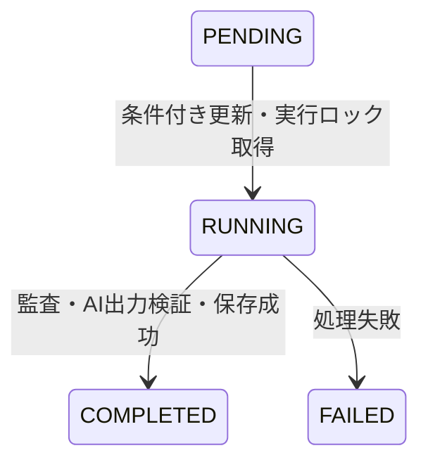

# Repo Sentinel — PoC実装計画

**状態:** Phase 1のローカル基本フローを実装・検証済み。確定した範囲は[ローカル基本仕様](../spec/local-basic.md)、確認根拠は[検証記録](../spec/phase1-verification.md)を参照する。本書の未実装部分は後続Phaseの要件とする。

本書はFrontend・API・データ・Worker・AIの固有要件を管理する。共通要件や手順は下表の担当文書に一本化し、本書へ複製しない。Phase 1ではFrontend、API、共有Zod契約、DynamoDB Local、モックWorker、履歴・ポーリング・結果表示を実装した。実認証、実GitHub・npm監査・AI、SQS、AWSインフラは未実装。本書の将来要件や例示を実装済みと扱わない。

## 参照先と担当範囲

| 内容 | 担当文書 |
|---|---|
| 目的・範囲・技術・設計原則・将来拡張 | [概要](../overview.md) |
| AWS/ローカルの構成・処理フロー・実行環境の境界 | [アーキテクチャ](../architecture.md) |
| 現行配置・workspace・共通パッケージ | [リポジトリ構成](../dev/repository.md) |
| Compose・依存管理・Proxy・コマンド・モック | [ローカル開発](../dev/local-development.md) |
| 認証・認可・外部入力・秘密情報・費用制限 | [セキュリティ要件](../security.md) |
| Terraform・環境分離・State・ビルド・監視 | [インフラ・運用](../infra/terraform.md) |
| 実装順序・各Phaseの完了条件・日常開発・権限確認 | [開発ワークフロー](../dev/workflow.md) |
| テスト項目・開発環境の受け入れ条件・PoC完了条件 | [検証計画](../testing.md) |
| 未確定の値・方式・決定時点 | [未確定事項](../decisions.md) |

要求の変更は担当文書に反映する。担当をまたぐ変更では関係する文書も整合させる。

## 機能要件の目次

- [フロントエンド](#frontend)
- [API](#api)
- [データ設計](#data-model)
- [Worker・機械監査](#worker)
- [AIレポート](#ai-report)

<a id="frontend"></a>

## フロントエンド

React + ViteのCSRアプリケーションとする。配置先は `frontend/app`。認証・通信の共通要件は[セキュリティ要件](../security.md)に従う。

### 画面

| 画面 | 必須内容 |
|---|---|
| 監査開始 | GitHubリポジトリURL入力、監査開始ボタン、入力値検証、実行中ジョブ表示 |
| 監査履歴 | 監査日時、リポジトリ名、状態、検出件数、詳細への遷移 |
| 監査結果 | 処理状態、対象コミット、脆弱性件数、深刻度別サマリー、AIレポート、監査エラー |

画面URL、履歴のページング、詳細の全レスポンス契約はPhase 1の範囲を[確定仕様](../spec/local-basic.md)に記録した。実監査・認証導入時の拡張は[未確定事項](../decisions.md)で管理する。

### 監査開始

- 対象条件は[Workerのリポジトリ指定](#worker)に従う。
- クライアント側の入力検証を行い、サーバー側でも同じ共有スキーマで検証する。
- `POST /api/audits` の `202 Accepted` と `jobId` を受け、状態取得を開始する。
- 実行中ジョブを表示する。利用上限や失敗はAPI契約に沿って表示する。

APIの要求・応答は [API仕様](#api)、データと状態は[データ設計](#data-model)に従う。

### ポーリング

- `GET /api/audits/:id` を2〜3秒間隔で取得する。
- `PENDING` / `RUNNING` 中の状態を表示する。
- `COMPLETED` または `FAILED` で停止する。
- 画面を離れた場合も停止する。

バックエンドからのプッシュ通知は使用しない。通信失敗時の再試行・停止条件はPhase 1の[確定仕様](../spec/local-basic.md)に従う。

### 結果表示

処理状態は[データ設計](#data-model)に従って表示する。

機械監査の検出結果とAIが生成した説明を区別する。対象コミット、監査日時、深刻度別件数をレポートの根拠として確認できるようにする。AIの限界・注意事項も表示する。

認証・トークン保持・ヘッダーは[セキュリティ要件](../security.md)、相対APIパスとProxy設定は[ローカル開発](../dev/local-development.md)を参照する。

<a id="api"></a>

## API

APIはHonoで実装し、ベースパスを `/api` とする。配置先は `api/app`。ローカルサーバーとLambdaエントリーポイントを分け、同じアプリ定義を使用する。

### 共通契約

- 全APIの認証・認可・利用制限は[セキュリティ要件](../security.md)に従う。
- 要求・応答はZodで定義し、`packages/core` を通じてFrontend・APIで共有する。
- 監査対象URLと `owner/repo` を検証し、任意URLのバックエンド取得を認めない。
- 対象ユーザーは検証済みJWTの `sub` を基準に扱う。

JWT専用ヘッダー・POSTハッシュの共通要件は[セキュリティ要件](../security.md)に従う。最終的なヘッダー契約とCloudFront転送との整合は[API-05](../decisions.md)で確定する。

### エンドポイント

| Method | Path | 用途 |
|---|---|---|
| POST | `/api/audits` | 監査ジョブ作成 |
| GET | `/api/audits` | 監査履歴取得 |
| GET | `/api/audits/:id` | 状態・結果取得 |

### 監査ジョブ作成

`POST /api/audits`

```json
{
  "repositoryUrl": "https://github.com/example/project"
}
```

処理順序：

1. JWTと許可ユーザーを検証する。
2. 入力URLを検証する。
3. 実行回数制限を検証する。同時リクエストで上限を突破できないようにする。
4. DynamoDBに `PENDING` ジョブを作る。
5. SQSへジョブIDを送る。ローカルはモックに置き換える。
6. `202 Accepted` を返す。

```json
{
  "jobId": "01EXAMPLE...",
  "status": "PENDING"
}
```

同時監査の実行ロックと回数制限の整合は[データ設計](#data-model)に従う。ローカルモックの通知・部分失敗は[確定仕様](../spec/local-basic.md)に記録した。実SQSの部分失敗はPhase 4で確定する。

### 監査履歴取得

`GET /api/audits`

認可されたユーザーの監査履歴を返す。画面には監査日時、リポジトリ名、状態、検出件数、詳細への遷移情報が必要。DynamoDBのULIDを利用し時系列で取得する。

要求クエリー、並び順、ページサイズ、継続トークン、応答エンベロープはPhase 1でZod契約を実装し、[確定仕様](../spec/local-basic.md)に記録した。

### ジョブ状態・結果取得

`GET /api/audits/:id`

基本仕様の完了時レスポンス例：

```json
{
  "jobId": "01EXAMPLE...",
  "repository": "example/project",
  "status": "COMPLETED",
  "createdAt": "2026-11-01T01:00:00Z",
  "finishedAt": "2026-11-01T01:00:35Z",
  "summary": {
    "critical": 0,
    "high": 2,
    "moderate": 3,
    "low": 1
  },
  "report": {
    "overallAssessment": "...",
    "summary": "...",
    "priorities": [],
    "recommendations": [],
    "limitations": []
  }
}
```

例は完全な確定スキーマではない。結果画面で必要な `commitSha`、想定影響の表現、`findings` の公開範囲、処理中・失敗時のフィールド有無を正式なZod契約で定義する。AIレポートの要件は[AIレポート仕様](#ai-report)を参照する。

### エラー・制限

未認証、未許可ユーザー、不正入力、利用上限、対象ジョブなし、キュー送信失敗などを扱う。Phase 1のHTTPステータス・エラー形式・コードは[確定仕様](../spec/local-basic.md)に記録した。実認証・実SQSのエラーは後続Phaseで拡張する。

利用制限・認証例外・APIキャッシュは[セキュリティ要件](../security.md)に従う。

<a id="data-model"></a>

## データ設計

### DynamoDBテーブル

初期PoCは1テーブルとし、ジョブ管理用メタデータも同じテーブルへ格納する。テーブル名の例は `security-audit-jobs-{environment}`。dev/prodは別テーブルにする。

```text
PK = USER#{sub}
SK = AUDIT#{ULID}
```

検証済みCognito `sub` でユーザーを識別し、ULIDで監査履歴を時系列に取得する。AWS SDK実装は `packages/aws` に置き、ローカルはDynamoDB Localへ接続する。

### ジョブ属性

| 属性 | 内容 |
|---|---|
| `jobId` | ジョブID（ULID） |
| `repository` | `owner/repo` |
| `commitSha` | 監査対象の確定コミット |
| `status` | `PENDING` / `RUNNING` / `COMPLETED` / `FAILED` |
| `createdAt` | 作成日時 |
| `startedAt` | 実行開始日時 |
| `finishedAt` | 処理終了日時 |
| `attemptCount` | 実行試行回数 |
| `summary` | 深刻度別の検出件数 |
| `findings` | 正規化した機械監査結果 |
| `report` | 検証済みAIレポート |
| `errorCode` | 処理失敗理由 |
| `expiresAt` | 任意の保存期限 |

状態ごとの必須・任意属性、正規化結果・レポートの正式型はZodで定義する。API公開型と保存型の境界も確定する。

保存データがDynamoDBアイテムサイズ上限を超える場合、初期PoCはエラーとして扱う。結果のS3分離は将来拡張とし、初期PoCでは実装しない。

### 状態遷移



脆弱性が検出されても、監査処理が成功していれば `COMPLETED` とする。脆弱性の有無とジョブの実行成否を分離する。

通常の遷移を示す。例外時の遷移・復旧方式は[API-04・DATA-02](../decisions.md)で設計する。

### 冪等性と実行リース

- SQS Standardは重複配信を前提とする。
- WorkerはDynamoDB条件付き更新により、`PENDING` → `RUNNING` に成功した場合のみ処理を開始する。
- 実行中ジョブにリース期限を持たせ、タイムアウトした処理を検出できるようにする。
- `COMPLETED` のジョブは再処理しない。
- 有料AI処理が[同時実行上限](../security.md)を超えないよう、アプリケーション側ジョブロックを設ける。
- 外部API呼び出しの完全な重複排除は保証できない。OpenAI呼び出し後の成否が不確実な失敗は、自動再実行を抑制する。

ジョブ状態の条件付き更新だけでは、複数の異なるジョブの同時AI実行を制限できない。全体ロック、リース、所有者確認、解放条件の具体形を設計する必要がある。WorkerのReserved Concurrencyは[Worker仕様](#worker)の設定に従う。

### 利用回数・管理メタデータ

日次回数などの管理メタデータも同じテーブルに置き、条件付き更新などで[利用上限](../security.md)を守る。メタデータ・原子性・リース・所有者解決・保持期間の具体化は[DATA-01〜04](../decisions.md)で管理する。

<a id="worker"></a>

## Worker・機械監査

### 処理本体とエントリーポイント

配置先は `workers/security-audit/app`。処理本体をLambdaに依存しない関数として実装する。

```typescript
async function runAudit(
  jobId: string,
  ownerSub: string
): Promise<void>
```

LambdaハンドラーはSQSイベントを処理本体へ変換し、ローカルエントリーポイントも同じ関数を呼ぶ。AWS固有のイベントを処理本体へ持ち込まない。

処理順序：

1. ジョブ取得。
2. 実行権限・所有者・状態の確認。
3. 実行ロック取得と条件付き状態更新。
4. GitHubから監査対象ファイル取得。
5. `npm audit` 実行。
6. 監査結果の正規化。
7. OpenAI API呼び出しと出力検証。
8. レポート保存。
9. ジョブ完了処理。

各処理に明示的なタイムアウトを設定する。状態・ロック・リースは[データ設計](#data-model)、AIは[AIレポート仕様](#ai-report)に従う。

### GitHubリポジトリの指定

入力形式：

```text
https://github.com/{owner}/{repository}
```

- 公開リポジトリのみ対象とする。
- GitHub APIでデフォルトブランチと最新コミットSHAを取得する。
- 取得したSHAのルート `package.json` と `package-lock.json` のみを監査する。
- ファイル取得時に同じSHAを使い、対象コミットを結果へ保存する。
- モノレポ内の個別ワークスペース、任意ブランチ・コミット指定には対応しない。
- GitHub以外の任意URLをバックエンドで取得しない。

`owner/repo` を検証し、各ファイルサイズと取得時間に上限を設定する。具体値、欠損・非対応lockfileの扱い、GitHub API認証方法は[未確定事項](../decisions.md)で確定する。

### npm audit

対象の2ファイルを一時ディレクトリに配置し、次を実行する。

```bash
npm audit --json --package-lock-only
```

対象リポジトリへの依存インストール・コード実行は禁止し、[外部入力・子プロセスの制約](../security.md)に従う。開発用workspace自身の依存追加とは区別する。

### 終了コードとエラー判定

脆弱性があると `npm audit` は正常なJSONを生成しても非ゼロ終了になる。終了コードだけで失敗と判定せず、JSON出力を解析する。

JSON生成・解析失敗、タイムアウト、npm Registry通信失敗などは監査エラーとする。監査成功で脆弱性が検出された場合は `COMPLETED` にできる。機械監査失敗時に根拠のないAIレポートを作らない。

### 正規化して保存する情報

- 依存パッケージ名。
- 検出された脆弱性。
- 深刻度。
- 影響を受けるバージョン。
- 修正可能性。
- アドバイザリ参照URL。
- 深刻度別の検出件数。

必要な情報へ正規化し、保存サイズを制限する。サマリー例の `critical` / `high` / `moderate` / `low` 以外の深刻度が出現する場合の扱いは、正式スキーマで決める。

### SQS・Lambda初期設定

| 項目 | 設定 |
|---|---|
| Queue Type | Standard |
| Batch Size | 1 |
| Worker Timeout | 180秒 |
| Visibility Timeout | 1,080秒 |
| DLQ | 有効 |
| `maxReceiveCount` | 2〜3（実装時に確定） |
| 同時監査ジョブ数 | 1件 |
| Worker Reserved Concurrency | 初期値2 |

Visibility TimeoutはWorker Timeoutの6倍を基準とする。Event Source Mappingの最大並列度を設定する場合はLambda設定と整合させる。

Reserved Concurrencyだけでは有料AI処理を制限できないため、[データ設計](#data-model)の全体ロックと[利用制限](../security.md)を併用する。

SQSメッセージはジョブIDを送る要件がある一方、処理本体は `ownerSub` も必要とする。メッセージの完全なスキーマと所有者の解決方式は未確定。失敗の種類ごとのメッセージ再試行・削除・DLQ移動条件も定義する。

ローカル実行コマンド、DynamoDB Local、AIモック切り替えは[ローカル開発](../dev/local-development.md)に従う。

<a id="ai-report"></a>

## AIレポート

### 役割

OpenAI Responses APIを使用し、機械監査結果を分析して人間向けのレポートを生成する。AIに監査ロジックの生成、インターネット検索、追加ツール利用、コード修正をさせない。

呼び出しはWorkerから行う。モデル名・プロンプト・出力トークン上限はサーバー側で固定し、クライアントから選ばせない。

### 入力

入力は次に限定する。

- リポジトリ識別子。
- 監査対象コミットSHA。
- 監査日時。
- 正規化したnpm audit結果。
- 深刻度別件数。

リポジトリ内の任意コードや、監査に不要な内容を入力へ追加しない。入力サイズには上限を設定する。具体的な上限とモデルは[未確定事項](../decisions.md)で確定する。

### 出力内容

| 内容 | 目的 |
|---|---|
| 総合評価 | 監査結果全体の説明 |
| 検出された問題の概要 | 機械監査結果の要約 |
| 優先的に確認すべき問題 | 確認優先度の提示 |
| 想定される影響 | 与えられた事実に基づく影響説明 |
| 推奨される対応 | 対応方針の提示 |
| 監査の限界・注意事項 | 判断の範囲と制約の明示 |

Structured Outputsを使用し、JSON Schemaに準拠した出力を取得する。保存前に共有スキーマで検証する。

基本仕様の例には `overallAssessment`、`summary`、`priorities`、`recommendations`、`limitations` があるが、想定影響の配置や配列要素型は定義されていない。6つの内容を満たす完全なスキーマを定義してからAPI・画面へ共有する。

### 事実とAI説明の区別

- 機械監査の検出結果・件数と、AIの説明・推論を区別する。
- 入力に根拠のないCVE番号、修正バージョン、検出結果を新たに生成させない。
- プロンプトと検証処理の両方で根拠のない追加情報を抑制する。
- 監査の限界・注意事項をレポートに含める。
- JSON Schemaへの適合と、内容の事実整合性は別に検証する。

事実整合性の具体的な照合方式や、拒否・不完全出力時のエラーコードは未確定。

### 実行制約

呼び出し回数・費用・秘密情報は[セキュリティ要件](../security.md)、成否不確実な呼び出しの再実行抑制は[データ設計](#data-model)に従う。SQS再配信とAI呼び出しの再試行を同一視しない。

AIモックの利用手順は[ローカル開発](../dev/local-development.md)、構造・事実整合性・上限・失敗・重複の検証は[検証計画](../testing.md)に従う。

<a id="coverage"></a>

## 旧要件の対応先

旧基本仕様書・変更要件書は統合時に照合して廃止済み。重複削除後も、要件は本書と担当文書を合わせて維持する。

| 旧文書の範囲 | 現在の担当文書 |
|---|---|
| 基本 §1–2・§15–16、変更 §11：目的・範囲・技術・原則 | [概要](../overview.md) |
| 基本 §3・§9.2：構成・処理・実行モード | [アーキテクチャ](../architecture.md) |
| 基本 §4.2–4.5・§5–7、旧specの5文書：機能・データ・非同期処理 | 本書の各機能要件 |
| 基本 §4.1・§8.1–8.4：認証・配信・外部入力・費用 | [セキュリティ](../security.md) |
| 基本 §9・§10、変更 §1–6・§9：ローカル環境・依存管理・配置 | [ローカル開発](../dev/local-development.md)・[リポジトリ構成](../dev/repository.md) |
| 基本 §8.5・§11、変更 §8：Terraform・AWS配信・ビルド・監視 | [インフラ・運用](../infra/terraform.md) |
| 基本 §12–13、変更 §7：実装Phase・日常開発・操作確認 | [開発ワークフロー](../dev/workflow.md) |
| 基本 §14、変更 §10：PoC完了12条件・開発環境14条件 | [検証計画](../testing.md) |
| 変更 §12：適用方針、原文の未定義事項 | [文書管理方針](../README.md)・[未確定事項](../decisions.md) |

変更要件を優先した統合結果と、現行リポジトリ構成を正とするユーザー指示を維持する。
