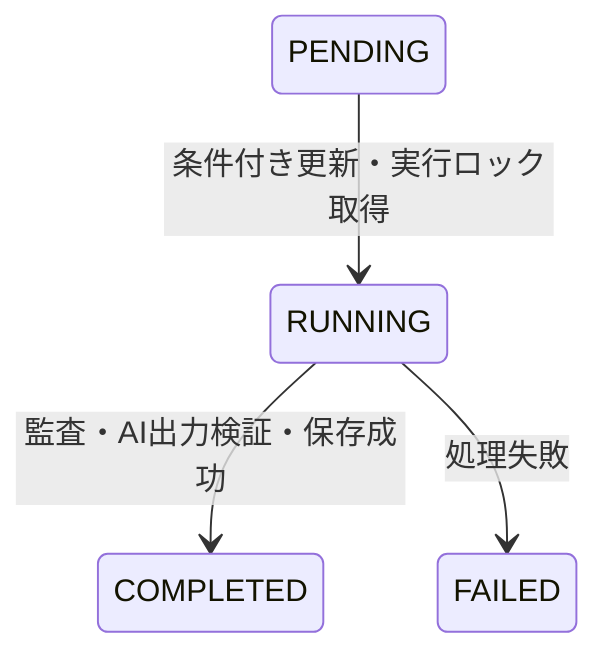

# データ設計

## DynamoDBテーブル

初期PoCは1テーブルとし、ジョブ管理用メタデータも同じテーブルへ格納する。テーブル名の例は `security-audit-jobs-{environment}`。dev/prodは別テーブルにする。

```text
PK = USER#{sub}
SK = AUDIT#{ULID}
```

検証済みCognito `sub` でユーザーを識別し、ULIDで監査履歴を時系列に取得する。AWS SDK実装は `packages/aws` に置き、ローカルはDynamoDB Localへ接続する。

## ジョブ属性

| 属性 | 内容 |
|---|---|
| `jobId` | ジョブID（ULID） |
| `repository` | `owner/repo` |
| `commitSha` | 監査対象の確定コミット |
| `status` | `PENDING` / `RUNNING` / `COMPLETED` / `FAILED` |
| `createdAt` | 作成日時 |
| `startedAt` | 実行開始日時 |
| `finishedAt` | 処理終了日時 |
| `attemptCount` | 実行試行回数 |
| `summary` | 深刻度別の検出件数 |
| `findings` | 正規化した機械監査結果 |
| `report` | 検証済みAIレポート |
| `errorCode` | 処理失敗理由 |
| `expiresAt` | 任意の保存期限 |

状態ごとの必須・任意属性、正規化結果・レポートの正式型はZodで定義する。API公開型と保存型の境界も確定する。

保存データがDynamoDBアイテムサイズ上限を超える場合、初期PoCはエラーとして扱う。結果のS3分離は将来拡張とし、初期PoCでは実装しない。

## 状態遷移



脆弱性が検出されても、監査処理が成功していれば `COMPLETED` とする。脆弱性の有無とジョブの実行成否を分離する。

上図は原文で定義された通常の遷移。キュー送信失敗、ロック競合、期限切れリースなどの遷移は[未確定事項](../decisions.md)で設計する。

## 冪等性と実行リース

- SQS Standardは重複配信を前提とする。
- WorkerはDynamoDB条件付き更新により、`PENDING` → `RUNNING` に成功した場合のみ処理を開始する。
- 実行中ジョブにリース期限を持たせ、タイムアウトした処理を検出できるようにする。
- `COMPLETED` のジョブは再処理しない。
- 有料AI処理を最大1件に制限するアプリケーション側ジョブロックを設ける。
- 外部API呼び出しの完全な重複排除は保証できない。OpenAI呼び出し後の成否が不確実な失敗は、自動再実行を抑制する。

ジョブ状態の条件付き更新だけでは、複数の異なるジョブの同時AI実行を制限できない。全体ロック、リース、所有者確認、解放条件の具体形を設計する必要がある。WorkerのReserved Concurrencyは[Worker仕様](worker.md)の設定に従う。

## 利用回数・管理メタデータ

監査開始の初期上限は[セキュリティ要件](../security.md)を正とする。日次回数などのメタデータを同じテーブルに置き、条件付き更新などで並列リクエストによる上限突破を防ぐ。

以下は原文に詳細がなく、実装前に確定する。

- メタデータのキー・属性、回数判定の日付境界。
- ジョブ作成と回数消費・ロックの原子性、失敗時の回数扱い。
- リース属性名・期間・更新方法、期限切れ検出と復旧。
- `attemptCount` の増加条件、AI実行前後の記録。
- Workerへの `ownerSub` の受け渡し、ローカルCLIでの所有者解決。
- 保存期限を使うかと、その保持期間・TTL設定。

これらの決定は[未確定事項](../decisions.md)と本書へ反映する。
